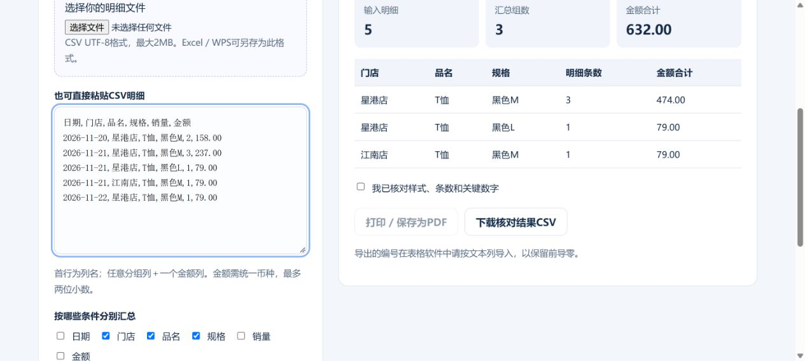
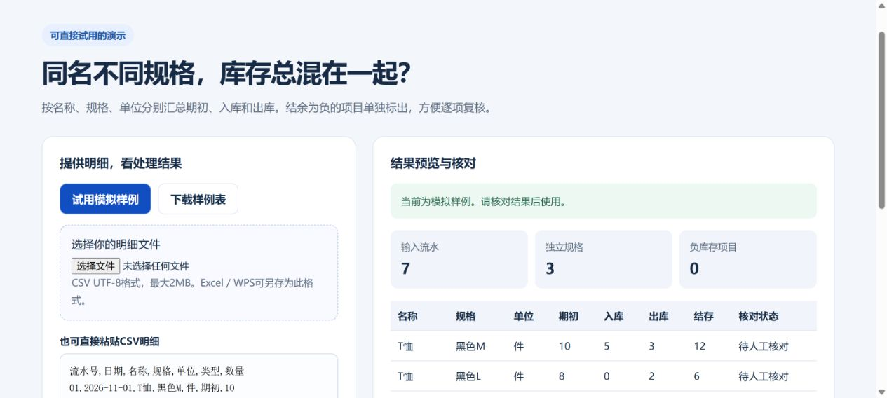

# 日常表格小帮手 / Daily Office Helpers

**在线试用 / Live demo:** [打开三个工具 / Open the tools](https://maxing08.github.io/office-work-helpers/)

三个可以实际操作的网页演示：按明细批量填付款单、明细自动汇总、按名称和规格核对库存。

打开工具后，点击 **试用模拟样例** 就能看到结果。示例数据均为模拟，适合先评估功能，再按自己的单据样式、表头和工作规则做定制。AI 辅助开发。


## 三个工具

| 工具 | 解决的工作场景 | 样例结果 |
| --- | --- | --- |
| [批量填付款单](https://maxing08.github.io/office-work-helpers/vouchers.html) | 每条明细都要单独填一张付款单 | 3 张付款单，合计 400.00 |
| [明细自动汇总](https://maxing08.github.io/office-work-helpers/summary.html) | 加了新明细，原来的汇总又要重做 | 4 条明细按门店、品名、规格形成 3 组，合计 553.00 |
| [进出库存核对](https://maxing08.github.io/office-work-helpers/stock.html) | 同名产品有不同规格，库存混在一起 | 黑色 M 为 12 件，黑色 L 为 6 件，A5 笔记本为 16 本 |

### 批量填付款单

一行明细生成一张付款单。预览后核对张数、金额、内容和打印版式，勾选核对项后可使用浏览器打印或保存为 PDF。单号重复、字段缺失、日期错误、非正付款金额会停止处理，先请使用者确认。

当前提供的是通用演示版式。客户原有付款单样式、签字栏、字段映射等可另行定制。


### 明细自动汇总

自行选择分组条件和金额列。编辑或增加明细后自动刷新，保留当前分组口径；遇到错误会清空失效结果并禁用导出。



### 进出库存核对

名称、规格、单位三者分别匹配，计算「期初＋入库－出库」。重复流水号、多条同口径期初库存会停止处理；结余为负的项目会标出，供工作人员复核原始流水。



## 如何试用

1. 下载整个目录或仓库 ZIP，解压后打开 `index.html`。三个工具不依赖账号、安装包或付费接口。
2. 点击模拟样例，确认是否接近自己的工作场景。
3. 用脱敏 CSV 明细试用，或直接粘贴 CSV 文本。
4. 按结果确认需要修改的版式、字段、汇总条件和其他规则。

文件在当前浏览器处理，不会被本项目上传到服务器。刷新页面会清空输入。导出的结果由使用者自行保存。

如需本机 HTTP 预览，安装 Node.js 的环境中可运行：

```sh
node server.cjs
```

然后打开终端打印的本机网址。网页运行本身不需要 Node.js。

## 输入范围

- 首版读取 **CSV UTF-8**；Excel / WPS 可以另存为此格式。原生 `.xlsx` 直接读取尚未实现。
- 单次文件最多 2MB、5000 行；付款单最多 200 张，方便分批核对。
- 日期使用 `YYYY-MM-DD`，金额最多两位小数，合计前请统一币种。金额按整数「分」计算，不使用浮点金额相加。
- 库存数量接受非负整数；类型为期初、入库、出库。不包含成本结转、财务记账、付款执行等功能。
- 原始编号在工具内按文本保留。CSV 再导入 Excel 时，应把编号列设为文本，避免表格软件自行去掉前导零。
- CSV 导出会转义可能被表格软件当成公式的文本。

## 样例文件

- [付款单输入](samples/vouchers.csv)
- [汇总输入](samples/summary.csv)
- [库存输入](samples/stock.csv)
- [负库存复核示例](samples/stock-negative.csv)

## 验证

核心规则测试：

```sh
node --test test/core.test.cjs
```

当前 16 项测试通过，覆盖 CSV 引号、换行和列结构；金额精度；重复编号、缺失字段和日期；多条件汇总；不同规格和单位；负库存；CSV 公式文本转义。

浏览器中已核验付款单张数和合计、核对勾选、汇总新增明细自动刷新、错误数据禁用导出，以及库存负数提示。CSV 生成内容已有测试；自动捕获浏览器下载事件未成功，完整打印输出也尚未进行文件级核验。手机窄屏显示尚未完成实际核验。

## 定制时先确认

提供 3 行脱敏输入、期望输出或空白样式、使用的软件和截止时间，再约定交付范围、总价、修改次数与验收规则。

---

## English

Three working, browser-based demos for repetitive office tasks: batch payment vouchers, detail summaries, and inventory checks by product name and specification.

Choose a tool and click **试用模拟样例** (Try simulated sample). All examples use simulated data. These are runnable demonstrations, not paid client case studies. Developed with AI assistance. The current interface is in Chinese.

### What the tools do

| Tool | Work problem | Sample result |
| --- | --- | --- |
| [Batch payment vouchers](https://maxing08.github.io/office-work-helpers/vouchers.html) | Each detail row needs its own payment voucher | Three vouchers, total 400.00 |
| [Detail summary](https://maxing08.github.io/office-work-helpers/summary.html) | New detail rows mean rebuilding the summary | Four rows grouped by store, product and specification; three groups, total 553.00 |
| [Inventory check](https://maxing08.github.io/office-work-helpers/stock.html) | Different specifications of the same product get mixed together | Black M: 12 units; black L: 6 units; A5 notebooks: 16 books |

**Payment vouchers:** Generate one voucher per input row, review the count, amounts and content, then enable browser printing or Save as PDF. Duplicate voucher IDs, missing required fields, invalid dates and non-positive amounts stop processing. The layout is a generic demo; an existing company template, signature fields and column mapping can be customized.

**Detail summary:** Select grouping columns and an amount column. Editing or adding input rows refreshes the totals while preserving the selected grouping. Invalid data clears outdated results and disables export.

**Inventory check:** Keep product name, specification and unit separate. Calculate opening balance + receipts − issues. Duplicate transaction IDs and repeated opening balances for the same group stop processing. Negative balances are flagged for review against the original records.

### Try it locally

1. Download the entire repository as a ZIP, extract it, and open `index.html`.
2. Select a tool and load its simulated sample.
3. Try a sanitized UTF-8 CSV file or paste CSV text.
4. Compare the result with your expected output before requesting changes.

No account, installation or paid API is needed for the web tools. Files are processed in the current browser; this project does not upload them to a server. Reloading clears the input. Save exported results yourself.

For an optional local HTTP preview with Node.js installed, run `node server.cjs` and open the local address printed in the terminal. Node.js is not required to open the tools directly.

### Input and scope

- The first version reads **UTF-8 CSV**. Excel and WPS can export this format. Direct native `.xlsx` input is not implemented.
- Limits: 2MB and 5,000 rows per file; up to 200 payment vouchers per batch.
- Use `YYYY-MM-DD` dates and monetary amounts with at most two decimal places. Normalize currencies before totaling. Amounts are calculated in integer minor units to avoid floating-point addition errors.
- Inventory quantities must be non-negative integers. Transaction types use the Chinese labels 期初 (opening), 入库 (receipt) and 出库 (issue).
- This is not an accounting, inventory costing or payment execution system.
- IDs are preserved as text inside the tools. When reimporting CSV into Excel, set identifier columns to text to retain leading zeros.
- CSV export escapes text that might otherwise be interpreted as a spreadsheet formula.

The [sample folder](samples/) contains voucher, summary, inventory and negative-balance examples. Screenshots above show the Chinese interface with simulated data.

### Validation

Run `node --test test/core.test.cjs`. The current 16 passing tests cover CSV quoting and structure, exact monetary totals, duplicate IDs, required fields, dates, multi-column summaries, product specifications and units, negative inventory, and CSV formula-text escaping.

Browser checks confirmed voucher counts and totals, the review checkbox, summary refresh after adding rows, disabled export on invalid data, and negative inventory warnings. CSV generation is tested; automatic browser download capture did not complete. Full printed output and narrow mobile layouts have not yet been fully verified.

### Customization

Provide three sanitized input rows, the expected output or blank template, the software you use, and a deadline. Agree on deliverables, a fixed total price, included revisions and acceptance criteria before custom development. Templates, column mappings, grouping rules and workflow-specific behavior can be adapted from these demos.
